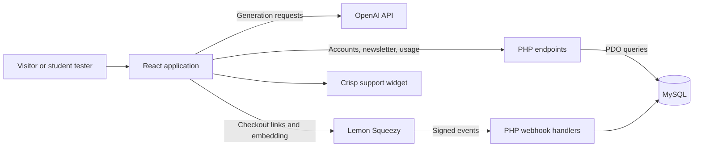
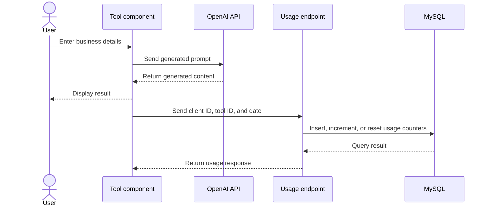

# Kotlibes — AI Marketing Workspace

**BTS (Bac+2) final-year educational project · React · PHP · MySQL**

Kotlibes brings AI-assisted marketing tools into one web application: creating buyer personas, writing a business USP, generating social content ideas, and drafting sales emails.

I built Kotlibes as my **projet de fin d’études for a BTS, a two-year post-secondary qualification (Bac+2)**. It was my first major full-stack project. Development took approximately a year alongside my studies, with work progressing around classes and academic commitments.

The project helped me explore the entire application lifecycle—from interface design and SQL queries to AI integration, usage tracking, and subscription experiments.

## Features

| Area | Supplied implementation |
|---|---|
| Marketing | Buyer persona and unique selling proposition generators |
| Social content | Instagram, TikTok, and LinkedIn content ideas; Instagram post scripts |
| Email writing | Sales and lead-generation email drafts |
| Accounts | Registration, sign-in, settings, and password reset |
| Dashboard | Daily, weekly, and yearly usage counts and stored-price estimates |
| Billing prototype | Pricing selection, Lemon Squeezy checkout, subscription handlers, and billing displays |
| Public website | Landing page, marketing carousel, story, FAQ, and newsletter signup |
| Support | Crisp initialization and experimental Calendly integration |

The catalog also includes advertising, SEO, customer-response, and roadmap cards. These are **placeholders**, not complete tools. The marketing strategy component is partial and its route remains disabled.

## Architecture



The original design calls the AI provider from the browser. PHP handles account data, newsletter records, usage reporting, and billing events. The diagram describes the supplied design; integrations require configuration and retain existing limitations.

## Content-generation flow



Usage is recorded in separate daily, weekly, and yearly tables using rolling date boundaries. Dashboard price totals use stored tool prices; they are estimates, not measured customer savings or provider costs.

## Technology stack

| Layer | Technologies |
|---|---|
| Interface | React 18, React Router, Bootstrap, Material UI, styled-components |
| HTTP and AI | Axios and the original OpenAI JavaScript SDK integration |
| Server | PHP and PDO |
| Storage | MySQL; supplied tables use MyISAM |
| Password-reset email | PHPMailer |
| Integrations | Lemon Squeezy, Crisp, Calendly |
| Visual components | Recharts and react-multi-carousel |

Dependency declarations and lockfiles preserve the supplied versions.

## Repository layout

```text
kotlibes/
├── backend/
│   ├── DbConnect.php       # Connection and shared HTTP headers
│   ├── login.php           # Account and subscription response
│   ├── newsletter.php      # Newsletter record creation
│   ├── incrementUsage.php  # Usage recording
│   ├── getUsage.php        # Usage aggregation
│   ├── resetPassword/      # Password reset and Composer dependencies
│   └── webhook/            # Billing handlers and inspection helpers
├── database/
│   └── schema.sql          # Supplied database structure
└── frontend/
    ├── hosting codes bach ykhdem/  # Original hosting references
    └── myapp/
        ├── public/         # HTML, public assets, and SPA fallback
        ├── src/
        │   ├── Pages/      # Public, account, tool, and experimental pages
        │   ├── components/ # Generators, navigation, and shared UI
        │   ├── assets/     # Images and fonts
        │   ├── App.js      # Routes
        │   └── App.css     # Shared styles
        └── package.json
```

## Running locally

You need Node.js/npm, PHP with PDO MySQL support, Composer, and a local MySQL database. The original dependency stack may require compatibility work with your environment.

1. Create a **disposable local database** and import `database/schema.sql`. The dump contains `DROP TABLE` statements; do not run it against a database you need to preserve.
2. Configure your private connection in `backend/DbConnect.php`.
3. Serve the PHP endpoints beneath `/api` on your local web server. The frontend defaults to `http://localhost:80` in `frontend/myapp/src/components/BaseURL.js` and appends `/api/...` to requests. Adjust the base address to match your server.
4. Install frontend dependencies and start the development server:

```sh
cd frontend/myapp
npm ci
npm start
```

5. Install password-reset dependencies if absent:

```sh
cd backend/resetPassword
composer install
```

6. Configure private AI, SMTP, and payment settings only when testing those integrations. Tool and variant records/prices must be configured separately; the schema does not provide the required seed data.

The frontend also provides `npm run build` and `npm test`. These are available scripts, not a claim that the original project passes them in every environment.

**Credentials:** keep original local secrets out of public commits. React environment variables are bundled into browser code and do not protect API keys. A production adaptation would need server-side secret handling.

## Educational scope and limitations

- Browser account checks and stored state do not replace server-side authorization; some redirects occur during rendering.
- The original AI integration uses a legacy SDK/model configuration that may need adaptation before live use.
- The USP generator retains a validation condition that can block generation.
- Some billing queries disagree with the schema, including `variants.status` versus `variants.name`. Payment handlers lack a complete, verified lifecycle.
- Usage recording does not deduct tokens. The alternate dashboard chart uses sample data.
- The newsletter endpoint prints a date before JSON, and frontend feedback has existing limitations. Signup stores records; it does not deliver campaigns.
- `/Test` is experimental. Some public and catalog links have no implemented destination.
- Hosting snippets preserve original reference paths and require adaptation before deployment.

These limitations reflect the supplied student project. They are not claims of working production functionality.

## What I learned

Kotlibes helped me practice React components and state, client/server communication, PHP endpoints, relational data modeling, SQL queries, prompt construction, and third-party integrations. It also showed me how much separates a classroom prototype from a secure, reliable application.

**Author:** Mohamed Reda El Ghazouani — [iiMedR](https://github.com/iiMedR)
